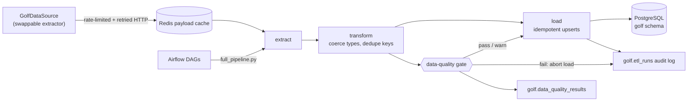

# Golf ETL Project (In Progress)

A data-engineering project that ingests PGA Tour player and season statistics
into a PostgreSQL warehouse, with incremental loads, season backfills, payload
caching and an Airflow schedule. A FastAPI backend and React frontend will sit
on top of the warehouse (not built yet).

## Architecture



| Layer | Path | Notes |
| --- | --- | --- |
| Extract | `etl/extract/` | source protocols (`base.py`); `pgatour_graphql.py` (stats + history) and `pgatour_pages.py` (player directory); `http.py` rate limiter + retries; `cache.py` Redis cache |
| Transform | `etl/transform/` | Normalises players/stats, coerces types, enforces the primary key |
| Quality | `etl/quality/`, `etl/database/quality.py` | Pure checks on the transformed frame, compared with the previous run; results stored in `golf.data_quality_results` |
| Load | `etl/load/`, `etl/database/` | Chunked, transactional `INSERT ... ON CONFLICT DO UPDATE` |
| Orchestration | `etl/pipeline/`, `etl/full_pipeline.py` | `runner.py` plans seasons and records every run |
| Scheduling | `airflow/dags/` | Daily incremental DAG + manual backfill DAG |
| API | `backend/app/` | FastAPI read API over the warehouse |
| Frontend | `frontend/` | React + TypeScript (Vite) UI: players, trends, leaderboards, compare, stats explorer, pipeline health |
| Schema | `db/01_schema.sql` | Idempotent DDL, applied automatically by docker compose |

### Design decisions

- **Swappable extractor.** The pipeline depends only on the `GolfDataSource`
  protocol. Moving to another provider means writing one class.
- **Polite scraping.** Global token-spacing rate limiter (`REQUESTS_PER_SECOND`),
  exponential-backoff retries on 429/5xx honouring `Retry-After`, an
  identifying User-Agent, and `robots.txt` respected (player and stats pages
  are not disallowed).
- **Redis payload cache.** Parsed payloads are cached (including "no stats"
  results), so re-runs and backfills don't re-hit the source. If Redis is down
  the pipeline logs a warning and runs uncached.
- **Idempotent loads.** Upserts keyed on `(player_id, season, stat_id)`; all
  chunks of a load run in one transaction; duplicate keys are rejected up front.
- **Auditability.** `golf.etl_runs` records each run's mode, season, status,
  row count and any skip reason.

## Getting started

```sh
cp .env.example .env              # set DB_PASSWORD
docker compose up -d              # Postgres (host port 5433) + Redis
# in .env: ETL_DB_PORT=5433, ETL_DB_NAME=ADHOC_GOLF

uv sync --dev      # Python is pinned to 3.12 (.python-version, requires-python)
source .venv/bin/activate   # or prefix commands with `uv run`
cd etl
uv run python full_pipeline.py --mode incremental
```

Without Docker, point `ETL_DB_*` (host, port, name, user) at any Postgres and apply `db/01_schema.sql`.

### Modes

```sh
python full_pipeline.py --mode incremental                       # players + current season
python full_pipeline.py --mode backfill                          # last 4 seasons
python full_pipeline.py --mode backfill --seasons 2024 2025 --force
python full_pipeline.py --mode incremental --stats-source pages  # current season via page data
```

Completed past seasons are skipped on re-run unless `--force` is passed. The
current season is always refreshed.

### Running the ETL with Airflow

Airflow runs the same `full_pipeline.py` CLI shown above, scheduled and
tracked. Everything runs in Docker; no local Airflow install is needed.

**1. Prerequisites**

- Docker with Compose v2.
- `.env` containing at least `DB_PASSWORD` and `PGA_GRAPHQL_KEY`
  (see `.env.example`). Compose passes these into the containers.

**2. Start the stack**

```sh
docker compose --profile airflow up -d --build   # Postgres, Redis, API, Airflow
docker compose ps                                # wait until postgres/redis are healthy
```

The first start builds the image (~2 min) and initializes Airflow's metadata
database (`airflow` DB in the same Postgres). The warehouse schema in
`ADHOC_GOLF` is created automatically on the first start of an empty volume.

**3. Log in**

Open http://localhost:8080 and sign in as `admin`. The generated password is
in the container:

```sh
docker compose exec airflow cat /opt/airflow/standalone_admin_password.txt
```

**4. The two DAGs** (both are paused on first start - flip the toggle to enable)

| DAG | Schedule | What it runs |
| --- | --- | --- |
| `golf_etl_incremental` | daily 08:00 UTC | `full_pipeline.py --mode incremental` - refresh players + current season |
| `golf_etl_backfill` | manual only | `full_pipeline.py --mode backfill` - last 4 seasons, or the ones you choose |

**5. Run a DAG now**

From the UI: open the DAG -> **Trigger DAG** (play button). For
`golf_etl_backfill` choose **Trigger DAG w/ config** and set the params:

```json
{"seasons": [2024, 2025], "force": true}
```

- `seasons`: list of seasons; empty list = last 4 seasons.
- `force`: `true` reloads seasons that are already loaded (otherwise skipped).

Or from the CLI:

```sh
docker compose exec airflow airflow dags unpause golf_etl_incremental
docker compose exec airflow airflow dags trigger golf_etl_incremental
docker compose exec airflow airflow dags trigger golf_etl_backfill \
    --conf '{"seasons": [2025], "force": false}'
docker compose exec airflow airflow dags list-runs -d golf_etl_incremental
```

**6. Check the result**

- Airflow UI -> DAG -> Grid -> task -> **Logs**. The last line summarises the
  run: `Done in ... | loaded={2026: 81551} skipped={} | cache hits=... misses=...`.
- The warehouse audit log records every run, including skips and failures:

```sh
docker compose exec postgres psql -U postgres -d ADHOC_GOLF -c \
  "select run_id, pipeline, mode, season, status, rows_loaded, detail, started_at
   from golf.etl_runs order by run_id desc limit 10"
```

**7. Stop**

```sh
docker compose --profile airflow down        # keep data (volumes)
docker compose --profile airflow down -v     # also delete the database and Airflow state
```

**Notes**

- A cold backfill makes ~400 rate-limited requests per season (~4 minutes
  each); repeat runs are served from the Redis cache.
- The ETL runs in its own virtualenv inside the image because Airflow 2.x pins
  SQLAlchemy < 2. `airflow standalone` is a dev-only all-in-one runner; a real
  deployment would use separate scheduler/webserver services and a proper
  executor.
- Unpausing a DAG makes Airflow create a run for the most recent missed
  schedule interval, so expect one immediate run for `golf_etl_incremental`.
- Retries, alerting and schedules are still defaults to be tuned. If a run
  fails, `golf.etl_runs.detail` holds the error and the task retries twice,
  10 minutes apart.

### Tournament data

After each season's stats, the runner loads that season's **schedule**
(`golf.tournaments`: name, dates, course, location, purse, category,
champion) and the **results** of every completed event
(`golf.tournament_results`: one row per player with status finished / cut /
wd / dq, numeric position and tie flag, total strokes, score to par, rounds
1-4, FedExCup points and official earnings). Both come from the same GraphQL
API as the stats (`schedule`, `tournamentPastResults`) and share its rate
limiting, retries and Redis cache. Tournaments have their own skip logic, so
a season whose stats are already loaded still gets its tournaments;
`--no-tournaments` skips them, and a tournament failure is recorded in
`golf.etl_runs` (pipeline `tournaments`) without stopping other seasons.

Guard: the champion in the schedule must be among the position-1 finishers of
the results, otherwise the load aborts with a data-quality error. This exists
because `tournamentPastResults` has a `year` argument that is *not* a calendar
year (its own season pills look like `20260`); an unrecognised value silently
returns the **latest edition**, so the id alone (`R2023002`) must select the
edition and `year` is never sent.

Not loaded yet: team and match-play events (Zurich Classic, Ryder Cup,
Presidents Cup) return team/match results instead of a player leaderboard, so
they appear in `golf.tournaments` without results.

### Keeping the current season fresh

Current-season payloads are cached for `CURRENT_SEASON_TTL_SECONDS` (default
1 hour; completed seasons for 30 days). Each load of a season replaces the
GraphQL-sourced rows for the stats that were fetched in one transaction, so
rows that disappear upstream (e.g. a player dropping off a leaderboard) are
removed rather than lingering. Rows from other sources, and stats that failed
to fetch, are left untouched.

### Data-quality gate

Every stats load is validated after transform and **before** anything is
written. Results are stored per run in `golf.data_quality_results` and shown
on the Pipeline page. A `fail` aborts the load (the run is recorded as failed
and the warehouse is untouched); a `warn` is logged and loads.

| Check | warn | fail |
| --- | --- | --- |
| `null_value_rate` (rows without a numeric value) | > 20% | > 40% |
| `null_rank_rate` | > 5% | > 20% |
| `row_count_drift` vs the previous successful run | < 90% (or > 150%) | < 80% |
| `stat_coverage` (distinct stats vs previous run) | < 90% | < 75% |
| `rank_validity`, `finite_values`, `rank_one_present` | n/a | any violation |

Baselines come from the last successful stats run for the season, so a first
load has nothing to drift against and those checks pass. To load despite a
failure (for example after a known upstream change), pass
`--ignore-quality-failures` to `full_pipeline.py`; results are still recorded.
Thresholds live in `etl/quality/checks.py`.

### Tests and CI

```sh
uv run pytest -q && uv run mypy etl backend && uv run black --check . && uv run isort --check-only .
```

GitHub Actions run formatting (black/isort), flake8, mypy + pytest (with a
Postgres service) and the frontend lint/typecheck/test/build on every push.

## API (FastAPI)

Read-only JSON API over the warehouse for the React/TypeScript frontend.

```sh
docker compose up -d --build api                  # http://localhost:8000
# or locally, from backend/:
cd backend && uv run uvicorn app.main:app --reload
```

Interactive docs and the OpenAPI schema (usable to generate TypeScript
types): http://localhost:8000/docs and `/openapi.json`.

| Endpoint | Purpose |
| --- | --- |
| `GET /health` | liveness + database check |
| `GET /api/v1/seasons` | seasons loaded, with player/stat/row counts |
| `GET /api/v1/players` | search/filter players (`search`, `country`, `active`, `has_stats`, `season`, `limit`, `offset`) |
| `GET /api/v1/players/{id}` | player profile, parsed bio, seasons with stats |
| `GET /api/v1/players/{id}/stats` | a player's stats (`season`, `stat_id`, `category`) |
| `GET /api/v1/players/{id}/stats/{stat_id}/history` | one stat across seasons (trend charts) |
| `GET /api/v1/stats` | stat catalogue (`search`, `category`) |
| `GET /api/v1/stats/categories` | category names for filter dropdowns |
| `GET /api/v1/stats/{stat_id}/leaders` | leaderboard (`season` defaults to latest, `limit`) |
| `GET /api/v1/compare` | 2-4 players side by side: `players` (repeat the param), `season`, `category`; one row per stat with each player's value and rank |
| `GET /api/v1/compare/history` | one stat across seasons for 2-4 players (`players`, `stat_id`) |
| `GET /api/v1/players/{id}/percentiles` | a player's percentile within the field for each stat (`season`, `category`); percentile = (field - rank) / (field - 1) x 100 |
| `GET /api/v1/stats/{stat_id}/movers` | biggest rank improvers/decliners between two seasons (`season`, `compare_to`, `limit`) |
| `GET /api/v1/stats/scatter` | one point per player for two stats (`x`, `y`, `season`) |
| `GET /api/v1/pipeline/status` | warehouse freshness, latest quality results, recent runs and an overall ok/warn/fail |

Design notes: the API connects with a read-only transaction (the database
rejects writes), uses parameterised SQL only (LIKE wildcards in search are
escaped), validates and caps paging parameters, and allows CORS from
`CORS_ORIGINS` (default: the Vite and CRA dev servers). Tests seed their own
rows in a rolled-back transaction, so they never touch real data.

## Frontend (React + TypeScript)

Vite + React 19 + TypeScript SPA in `frontend/`, reading the API above.

```sh
docker compose up -d --build web     # http://localhost:3000 (needs the api service)
# or for development with hot reload:
cd frontend && npm install && npm run dev      # http://localhost:5173
```

| Page | Route | What it shows |
| --- | --- | --- |
| Players | `/` | name search, season and active filters, paging (state lives in the URL) |
| Player | `/players/:id` | profile, per-season stats table (category and text filters), trend chart of the selected stat across seasons |
| Leaderboards | `/leaders` | top N for any stat and season |
| Stats | `/stats?tab=profile\|movers\|scatter` | **Percentile profile** (one player, category chips, lollipop vs the field median), **Improvers & decliners** (diverging rank-change bars between seasons), **Scatter explorer** (any two stats, up to 3 highlighted players, regression line with r, table view) |
| Pipeline | `/pipeline` | overall health banner with reasons, per-season freshness, latest data-quality results and recent runs (auto-refreshes) |
| Compare | `/compare?p=0:<id>&p=1:<id>` | pick 2-4 players: multi-line trend of a stat across seasons plus a head-to-head table that highlights the best rank per row |

Design notes:

- **Typed contract.** API types are generated from the backend's OpenAPI
  schema (`npm run gen:api`, API must be running) into
  `src/api/schema.d.ts`; re-run it when the API changes. TanStack Query
  handles caching, cancellation and retries; 4xx responses are not retried.
- **Chart.** Single-series line (value on the only y-axis; rank appears in the
  tooltip and table, never a second scale), with a crosshair + tooltip, a
  Chart/Table toggle so the data never depends on colour or hover, and
  light/dark palettes. Recharts is code-split so list pages stay small.
- **Compare view.** Series identity is colour *and* marker shape (circle,
  square, diamond, triangle) with a legend that carries each player's latest
  value, so it works without colour or hover. Colours come from a palette
  checked with the dataviz validator (CVD-safe adjacent pairs in both modes;
  the low light-mode contrast of aqua/yellow is covered by the legend labels,
  shapes and table view). A player keeps their colour when another is removed
  (slot stored in the URL: `p=<slot>:<id>`, so links are shareable). "Best"
  is the lowest *rank*, which is correct whether a stat is higher-is-better or
  lower-is-better.
- **Stats views.** Percentile and rank-change rows state their numbers in
  text ("88th percentile, #22 of 180"; "#118 to #26"), so the bars are
  redundant encodings. Movers use a diverging blue/red pair around a neutral
  centre line on *rank* change (so "up" is right for lower-is-better stats);
  the latest season is flagged as in progress. The scatter keeps every player
  as a neutral point and highlights at most three, since all-pairs
  separation is only validated for three categorical colours.
- **Pipeline status.** Status is always icon + label + colour. Seasons
  without a successful load in 36 hours are flagged stale.
- **Accessibility.** Semantic tables with captions, labelled controls, a
  skip link, visible focus, `role="alert"` errors with retry, and a text
  summary of the chart for screen readers.
- **Config.** `VITE_API_URL` (default `http://localhost:8000`) is baked in at
  build time because the browser calls the API directly; the API must list the
  web origin in `CORS_ORIGINS` (defaults include `localhost:5173` and `:3000`).
  In Compose, set `PUBLIC_API_URL` if the API is not at `localhost:8000`.

```sh
cd frontend && npm run lint && npm run typecheck && npm test && npm run build
```

## Data sources

| Source | Class | Serves | Used for |
| --- | --- | --- | --- |
| Page data (`__NEXT_DATA__`) | `PGATourPageSource` | current season | player directory; `--stats-source pages` |
| PGA Tour GraphQL `StatDetails` | `PGATourGraphQLSource` | current + history (2004+) | season stats (default) |

The GraphQL source fetches one whole-season leaderboard per stat (~400 stats
per season, all players at once) instead of one request per player. Rows map
into `golf.player_stats` as `stat_value` (first column), `supporting_stat`
(second), `supporting_value` (last), and every column the API returned is kept
in the `details` JSONB column. Players that appear in historical leaderboards
but not in the current directory are stubbed so the foreign key holds.

Set `PGA_GRAPHQL_KEY` in `.env` (see `.env.example`). It is the key the public
website ships to browsers; never commit it.

## Known limitations

- Both sources read **undocumented** pgatour.com interfaces that can change
  without notice. Request rates are deliberately low and cached (completed
  seasons are cached for 30 days). Review pgatour.com's terms of use before
  any non-personal use. The GraphQL host publishes no robots.txt.
- Leaderboards only include players ranked in each stat, so a player's
  `player_stats` rows exist only for seasons where they qualified.
- `above_or_below` is not provided by the GraphQL source (NULL for those rows).

## Roadmap

- [x] FastAPI service over the warehouse
- [x] React + TypeScript frontend (players, player detail + trend chart, leaderboards)
- [x] Frontend: compare players, stats explorer (percentiles, movers, scatter), pipeline health
- [x] Data-quality gate in the pipeline
- [x] Tournament schedule + results (ETL)
- [ ] Tournament API endpoints and UI (tournaments list, results, player history)
- [ ] Per-tournament stats (`StatDetails` `eventQuery`, `EVENT_ONLY` / `THROUGH_EVENT`)
- [ ] Team / match-play event results
- [ ] Frontend: course pages
- [ ] Course statistics
- [ ] Dependabot, integration tests against a Postgres service container
