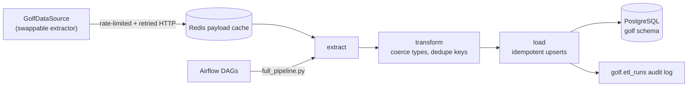

# Golf ETL Project (In Progress)

A data-engineering project that ingests PGA Tour player and season statistics
into a PostgreSQL warehouse, with incremental loads, season backfills, payload
caching and an Airflow schedule. A FastAPI backend and React frontend will sit
on top of the warehouse (not built yet).

## Architecture



| Layer | Path | Notes |
| --- | --- | --- |
| Extract | `etl/extract/` | `GolfDataSource` protocol (`base.py`); `pgatour_pages.py` is the current implementation; `http.py` rate limiter + retries; `cache.py` Redis cache |
| Transform | `etl/transform/` | Normalises players/stats, coerces types, enforces the primary key |
| Load | `etl/load/`, `etl/database/` | Chunked, transactional `INSERT ... ON CONFLICT DO UPDATE` |
| Orchestration | `etl/pipeline/`, `etl/full_pipeline.py` | `runner.py` plans seasons and records every run |
| Scheduling | `airflow/dags/` | Daily incremental DAG + manual backfill DAG (scaffold) |
| Schema | `db/01_schema.sql` | Idempotent DDL, applied automatically by docker compose |

### Design decisions

- **Swappable extractor.** The pipeline depends only on the `GolfDataSource`
  protocol. Moving to another provider means writing one class.
- **Polite scraping.** Global token-spacing rate limiter (`REQUESTS_PER_SECOND`),
  exponential-backoff retries on 429/5xx honouring `Retry-After`, an
  identifying User-Agent, and `robots.txt` respected (player and stats pages
  are not disallowed).
- **Redis payload cache.** Parsed payloads are cached (including "no stats"
  results), so re-runs and backfills don't re-hit the source. If Redis is down
  the pipeline logs a warning and runs uncached.
- **Idempotent loads.** Upserts keyed on `(player_id, season, stat_id)`; all
  chunks of a load run in one transaction; duplicate keys are rejected up front.
- **Auditability.** `golf.etl_runs` records each run's mode, season, status,
  row count and any skip reason.

## Getting started

```sh
cp .env.example .env              # set DB_PASSWORD
docker compose up -d              # Postgres (host port 5433) + Redis
# in .env: ETL_DB_PORT=5433

uv sync --dev
cd etl
uv run python full_pipeline.py --mode incremental
```

Without Docker, point `ETL_DB_*` at any Postgres and apply `db/01_schema.sql`.

### Modes

```sh
python full_pipeline.py --mode incremental                       # players + current season
python full_pipeline.py --mode backfill                          # last 4 seasons
python full_pipeline.py --mode backfill --seasons 2024 2025 --force
python full_pipeline.py --mode incremental --all-players         # not just active PGA Tour players
```

Completed past seasons are skipped on re-run unless `--force` is passed. The
current season is always refreshed.

### Airflow (scaffold)

```sh
docker compose --profile airflow up -d --build   # UI on http://localhost:8080
```

`golf_etl_incremental` runs daily; `golf_etl_backfill` is triggered manually
with optional `seasons` / `force` params. The ETL runs in its own virtualenv
inside the image because Airflow 2.x pins SQLAlchemy < 2. The compose and DAG
files have not yet been exercised end-to-end.

### Quality checks

```sh
uv run pytest -q && uv run mypy etl && uv run black --check . && uv run isort --check-only .
```

GitHub Actions run formatting (black/isort), flake8, and mypy + pytest on every push.

## Known limitations

- **No historical seasons from the current source.** pgatour.com server-renders
  only the *current* season (`?season=`/`?year=` are ignored; past seasons load
  client-side). `backfill` therefore records past seasons as `skipped` until a
  source that serves history is plugged in (e.g. a licensed provider). History
  accumulates going forward through incremental runs.
- The extractor reads the site's embedded Next.js page data, which is not a
  documented API and can change without notice. Keep request rates low and
  review pgatour.com's terms of use before any non-personal use.

## Roadmap

- [ ] Historical source for backfill
- [ ] FastAPI service over the warehouse
- [ ] React frontend
- [ ] Course statistics
- [ ] Dependabot, integration tests against a Postgres service container
